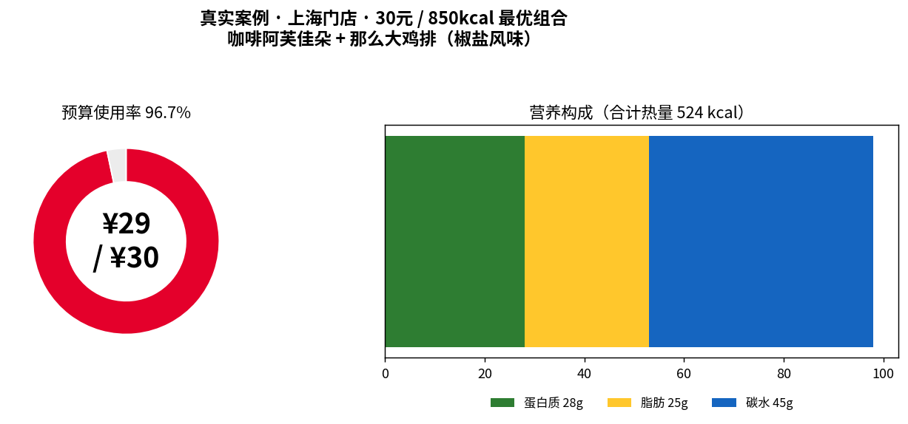
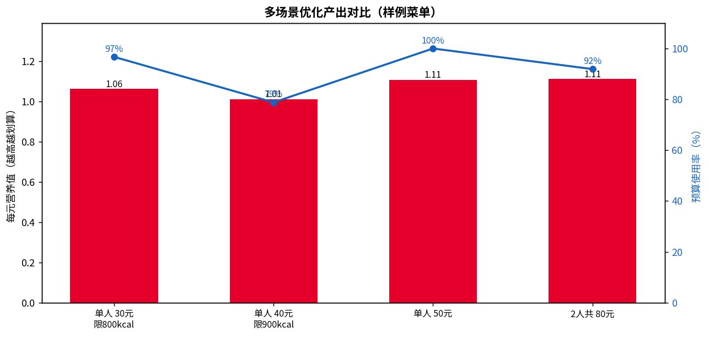

# 🍔 麦门组合优化器 · mcd-combo-optimizer

> 用**运筹优化**在预算与热量约束下，从麦当劳菜单中挑出「营养性价比最高」的套餐组合。
> 真实调用 **麦当劳 MCP**（菜单 / 营养 / 计价），并封装为 **WorkBuddy Skill**，开箱即用地解决「XX 元在麦当劳怎么吃最划算 / 最营养 / 最均衡」。

---

## ✨ 核心亮点

- 🧮 **真·运筹优化**：把点餐建模为「预算 + 热量 + 均衡约束」下的 0/1 整数规划，给出**理论最优解**，而非又一款"省钱计算器"。
- 🔌 **真实 MCP 闭环**：`query-meals → list-nutrition-foods → 优化 → calculate-price` 端到端打通，结果经官方算价**交叉验证一致**。
- 🤖 **WorkBuddy 原生 Skill**：开箱即用，自然语言即可触发（"30 元配份不超过 850 大卡的套餐"）。
- 🪶 **零依赖可跑**：未装 PuLP 时自动回退启发式求解器；内置样例菜单，**无需 Token 即可离线验证算法**。
- 📊 **可视化演示**：真实案例 + 多场景对比图，直观展示"每元营养值最大化"。

## 项目简介

「麦门组合优化器」把点餐变成一个**带约束的最优化问题**：

- 给定 **预算（元）**、可选 **热量上限（kcal）**、**人数**；
- 从麦当劳菜单中挑选一组餐品，使 **营养性价比**（蛋白质 + 0.3×能量/100）最大化；
- 同时满足 **均衡搭配约束**（至少 1 主食 + 1 饮料）。

它不是又一款「省钱计算器」，而是用 **0/1 整数规划 / 背包模型** 给出**理论最优解**——这正是它区别于榜单上 20+ 个「省钱/优惠券」项目的差异化记忆点。

### 目标用户
- 想「花得少、吃得营养」的麦门信徒；
- 健身 / 控卡人群（热量约束下的最优搭配）；
- 多人拼单 / 团餐（按人数自动放大预算与热量）；
- 对「AI + 运筹 + 真实 MCP 工具」感兴趣的开发者和评委。

---

## 优化模型

| 元素 | 定义 |
|---|---|
| 决策变量 | `x_i ∈ {0,1}`：是否选择第 `i` 个餐品 |
| 目标函数 | `max Σ (蛋白质_i + 0.3 × 能量_i / 100)` —— 营养性价比代理指标 |
| 约束 1 | `Σ 价格_i·x_i ≤ 预算` |
| 约束 2 | `Σ 能量_i·x_i ≤ 热量上限`（可选） |
| 约束 3 | `Σ x_i(主食标签) ≥ 1`（可选，均衡搭配） |
| 约束 4 | `Σ x_i(饮料标签) ≥ 1`（可选，均衡搭配） |

**求解器**：
1. **PuLP + CBC 精确整数规划**（首选，给出全局最优）；
2. 若环境未安装 PuLP，**自动回退**到「贪心 + 局部搜索 + 约束补齐」启发式，**零依赖也能跑通**。

---

## 安装

```bash
pip install -r requirements.txt   # 推荐安装 PuLP 以获精确解
```

> 不装 PuLP 也能用：优化器会自动切换到内置启发式求解器。

---

## 快速开始（无需 Token，离线可跑）

项目内置 `src/data/menu_sample.json` 样例菜单，评委与使用者无需麦当劳 Token 即可验证算法：

```bash
# 单人 30 元，限 800 kcal，必须含主食+饮料
python3 src/optimizer.py --budget 30 --calorie-cap 800 --require-main --require-drink

# 双人 80 元，必须含主食+饮料（预算/热量自动按人数放大）
python3 src/optimizer.py --budget 80 --people 2 --require-main --require-drink

# 输出 JSON（便于程序/WorkBuddy 调用）
python3 src/optimizer.py --budget 50 --require-main --require-drink --json
```

### 示例输出（单人 40 元 / 限 900 kcal / 主食+饮料）

```
==============================================
🍔 麦门组合优化结果（1 人）
==============================================
  · 巨无霸            ¥24.5   540kcal 蛋白26g [主食]
  · 豆浆             ¥7.0    80kcal 蛋白4g [饮料/早餐]
----------------------------------------------
  合计价格   : ¥31.5  (预算 ¥40.0，使用 78.8%)
  合计热量   : 620 kcal (上限 900.0)
  合计蛋白质 : 30 g
  合计碳水   : 51 g  脂肪 30 g
  营养性价比 : 31.86  (每元 1.011)
==============================================
# 求解器: 启发式(零依赖) | 候选餐品: 21 项
```

### 示例输出（单人 50 元 / 主食+饮料，不限热量）

```
==============================================
🍔 麦门组合优化结果（1 人）
==============================================
  · 麦辣鸡腿堡          ¥21.0   515kcal 蛋白23g [主食]
  · 板烧鸡腿堡          ¥22.0   520kcal 蛋白25g [主食]
  · 豆浆             ¥7.0    80kcal 蛋白4g [饮料/早餐]
----------------------------------------------
  合计价格   : ¥50.0  (预算 ¥50.0，使用 100.0%)
  合计热量   : 1115 kcal
  合计蛋白质 : 52 g
  合计碳水   : 102 g  脂肪 50 g
  营养性价比 : 55.35  (每元 1.107)
==============================================
```

---

## 📊 效果演示

### 真实案例（Live · 上海门店 · 30 元 / 850 kcal）

下图由**真实调用麦当劳 MCP** 拿到的门店菜单与营养数据驱动优化生成，并经官方 `calculate-price` 核验：



- 最优组合：**咖啡阿芙佳朵（¥15）+ 那么大鸡排（椒盐风味）（¥14）= ¥29.0**
- 预算使用率 **96.7%**，合计 **524 kcal / 蛋白 28 g**
- 与官方算价 **完全一致**（详见 [`mcp_live_evidence.md`](./mcp_live_evidence.md)）

### 多场景优化产出（样例菜单）

不同预算 / 热量约束下，优化器都能稳定给出「每元营养值最高」的组合，且预算利用率合理：



---

## 接入真实麦当劳 MCP（Live 模式）

配置 MCP（见 `mcp-config.example.json`，Token 用环境变量占位，避免明文）：

```bash
export MCD_MCP_TOKEN="你的真实Token"
# 在 WorkBuddy / Cursor / Cherry Studio 中按文档配置 mcd-mcp 连接器
```

在 WorkBuddy 中直接对 Skill 说：「**用 40 元帮我配一份不超过 900 大卡、有主食有饮料的麦当劳套餐**」，Skill 会自动：
1. 调 `query-meals` 取当前门店菜单（价格 / 分类 / 标签）；
2. 调 `list-nutrition-foods` 取营养数据；
3. 合并后喂给 `optimizer.py` 求最优组合；
4. 调 `calculate-price` 叠加优惠券核验总价。

> 菜单 / 价格 / 营养以麦当劳 MCP 实时返回为准；样例仅用于离线演示。

---

## Live 验证证据（真实 MCP 调用闭环）

本项目已完成 **真实 MCP 调用闭环验证**：以官方 `query-nearby-stores` → `query-meals` → `list-nutrition-foods` 取真实门店 / 菜单 / 营养，喂给 `optimizer.py` 求最优，再用 `calculate-price` 官方算价核验。验证使用**真实数据**（上海门店 115 项真实餐品、160 条真实营养），优化组合 **¥29.00** 与官方算价 **完全一致**。

📄 完整证据（门店、真实数据快照、优化结果、算价交叉验证、安全声明）：**[`mcp_live_evidence.md`](./mcp_live_evidence.md)**

> ⚠️ 安全提示：麦当劳 MCP 共 35 个工具，其中 16 个为写操作（下单 / 领券 / 抽奖等）。本次验证**仅调用只读 + 算价工具，零下单、零修改账户**。参赛者日常自测请勿调用写操作工具。

---

## 目录结构

```
mcd-combo-optimizer/
├── README.md                       # 项目说明（本文件）
├── CONTEST_DECLARATION.md          # 参赛声明（官方原文，不可修改）
├── MCP_INTEGRATION.md              # MCP 工具调用说明（必交）
├── mcp_live_evidence.md            # Live 验证证据（真实 MCP 闭环 + 安全声明）
├── mcp-config.example.json         # 脱敏 MCP 配置（仅环境变量占位）
├── workbuddy.md                    # WorkBuddy 开发对话上下文（联动奖励）
├── requirements.txt                # 依赖（pulp，可选）
├── skill/
│   └── SKILL.md                    # WorkBuddy Skill 定义
└── src/
    ├── optimizer.py                # 组合优化核心（CLI + 可调用）
    ├── visualize.py                # 演示图生成（README 配图）
    └── data/
        └── menu_sample.json        # 离线样例菜单
docs/
├── fig_real_case.png               # 真实案例演示图（Live MCP 数据）
└── fig_scenarios.png               # 多场景优化对比图
```

---

## 参赛说明

本项目参加 **麦当劳程序员节创意开发大赛**（2026-10-09 ~ 2026-10-25）。
- 真实使用 **麦当劳 MCP** 能力（`query-meals` / `list-nutrition-foods` / `calculate-price`）；
- 真实使用 **腾讯 WorkBuddy** 智能体开发并发布（`workbuddy.md` 为证）；
- 排名按 GitHub **公开 Star** 数，欢迎 Star ⭐ 支持！

---

## 免责声明

本项目为大赛参赛作品，由参赛者独立开发，**非麦当劳官方产品**。优化结果仅供参考，**不构成任何营养、医疗或健康建议**；餐品信息、价格及供应状态以麦当劳官方渠道实时结果为准。请理性点餐、均衡饮食。
